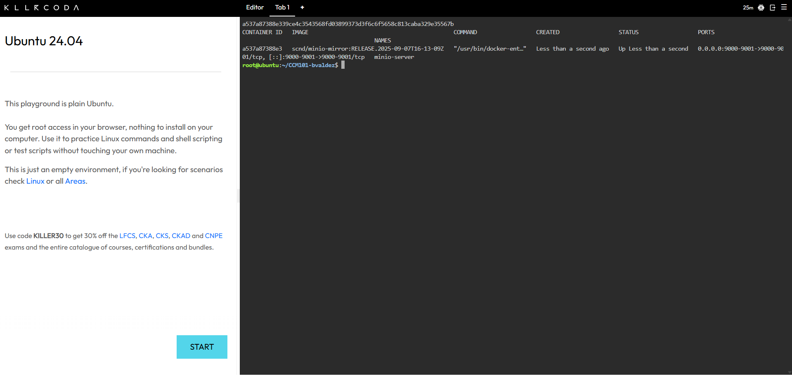
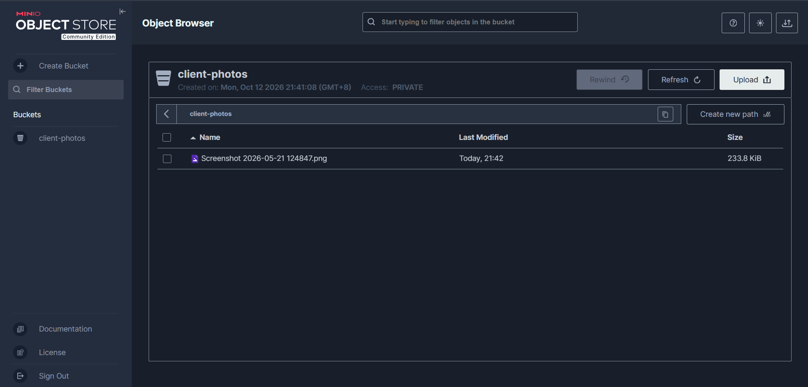

# MinIO Deployment Documentation

## Overview
This document records how I deployed a MinIO S3-compatible object storage server using Docker in a KillerCoda Ubuntu Playground, then created a bucket and uploaded a test file.

## Docker Command Used

```bash
docker run -d -p 9000:9000 -p 9001:9001 --name minio-server \
-e "MINIO_ROOT_USER=cloudadmin" \
-e "MINIO_ROOT_PASSWORD=CloudNova2026!" \
minio/minio server /data --console-address ":9001"
```

## Port Numbers
- **9001**: web console port, used to access the MinIO management interface through KillerCoda's Traffic / Ports feature.
- **9000**: S3 API port, used by applications to talk to the storage server.

## Bucket Created
- **Name:** `client-photos`

## Explanation of the `-e` Flags
The `-e` flag sets an environment variable inside the container when it starts.
- `MINIO_ROOT_USER=cloudadmin` sets the username of the administrator account for the MinIO console.
- `MINIO_ROOT_PASSWORD=CloudNova2026!` sets the password for that account.

Together they define the root login credentials without editing any configuration files inside the container.

## Other Parts of the Command
- `-d` runs the container in the background (detached mode).
- `-p 9000:9000 -p 9001:9001` maps the container ports to the host so they can be reached from outside.
- `--name minio-server` gives the container a readable name.
- `minio/minio` is the Docker image used.
- `server /data` starts MinIO and stores its data in the `/data` directory.
- `--console-address ":9001"` sets the web console to run on port 9001.

## Steps Taken
1. Launched a KillerCoda Ubuntu Playground.
2. Ran the `docker run` command above.
3. Verified the container was running with `docker ps`.
4. Opened port 9001 through the Traffic / Ports menu and logged in to the console.
5. Created the `client-photos` bucket.
6. Uploaded a sample file to the bucket.

## Evidence

### MinIO deployed


### Bucket and uploaded file


