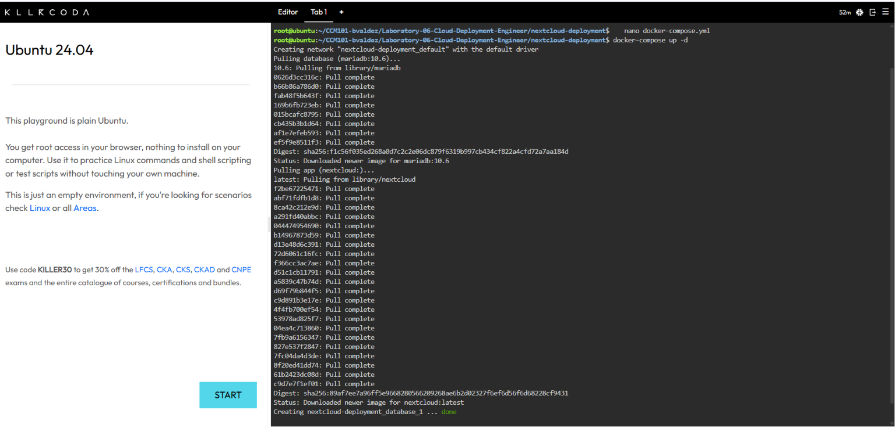
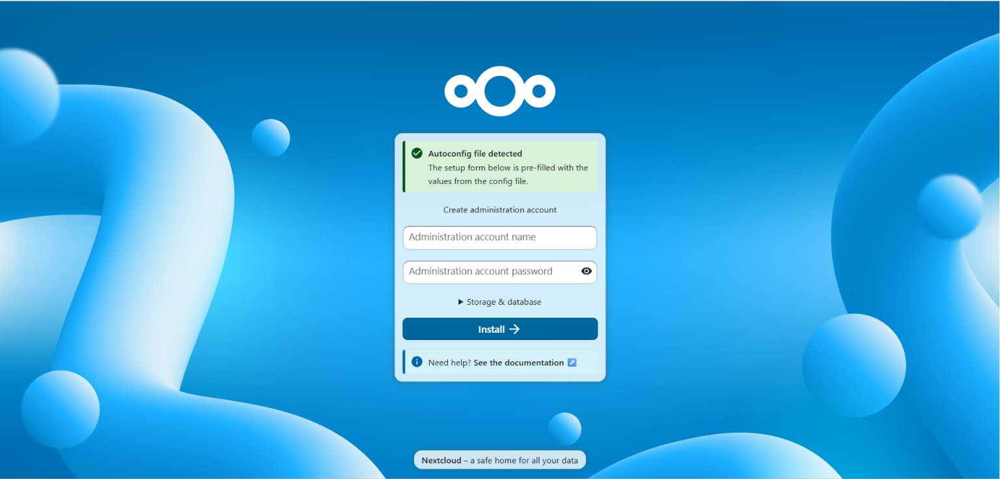
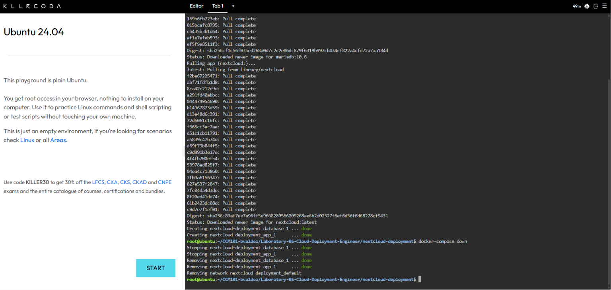

# Laboratory 6: The Cloud Deployment Engineer

**Course:** CCM101 – Cloud Computing, University of Eastern Pangasinan (College of Information Technology)

## Mission Overview

In this mission, I moved from deploying single containers to deploying a multi-tier application using Docker Compose and Infrastructure as Code (IaC). Working as a member of the Cloud Deployment Team at CloudNova Technologies, I wrote a `docker-compose.yml` file that defines a MariaDB database container and a Nextcloud web container, deployed both with a single command in a KillerCoda Ubuntu Playground, accessed the Nextcloud setup page through port 8080, and then tore the stack down.

## Objectives

- Explain the concept of a multi-tier application architecture.
- Understand the purpose and structure of a `docker-compose.yml` file.
- Use a Linux command-line text editor (nano) to create configuration files.
- Deploy a multi-container application (Nextcloud + database) using Docker Compose.
- Document deployment procedures and IaC principles using Markdown.
- Continue expanding my professional GitHub Cloud Computing Portfolio.

## Commands Executed

```bash
mkdir nextcloud-deployment      # create the project directory
cd nextcloud-deployment         # move into it
nano docker-compose.yml         # write the Compose file
docker-compose up -d            # deploy the stack in the background
docker-compose ps               # verify both containers are running
docker-compose down             # stop and remove the stack
nano
```

## Evidence

### 1. Multi-Container Deployment

Running `docker-compose up -d` and `docker-compose ps` showed both the MariaDB database container and the Nextcloud app container in the **Up** state.



### 2. Nextcloud Web Interface

Accessing port 8080 through the KillerCoda Traffic / Ports tab opened the Nextcloud setup page, confirming the app container was reachable and running.



### 3. Stack Teardown

Running `docker-compose down` stopped and removed the containers and network.



## Skills Learned

- Describing a two-tier architecture (application tier and database tier).
- Writing a valid YAML configuration file with correct space-based indentation.
- Editing files from the terminal with nano.
- Defining multiple services, ports, and environment variables in Docker Compose.
- Deploying and tearing down a full stack with one command each.
- Understanding how containers find each other by service name on a Compose network.
- Exposing a containerized application through a port mapping and accessing it via KillerCoda.
- Documenting infrastructure and organizing evidence in a GitHub repository.

## Contents

| File | Description |
|------|-------------|
| `multi-tier-architecture.md` | Two-tier architecture research |
| `docker-compose-guide.md` | Explanation of the Compose file |
| `reflection.md` | Mission reflection |
| `screenshots/` | Deployment, web access, and teardown evidence |
