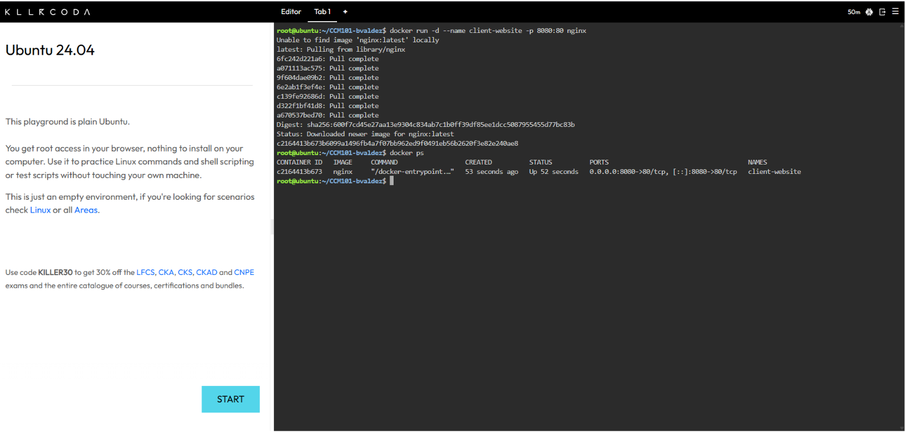
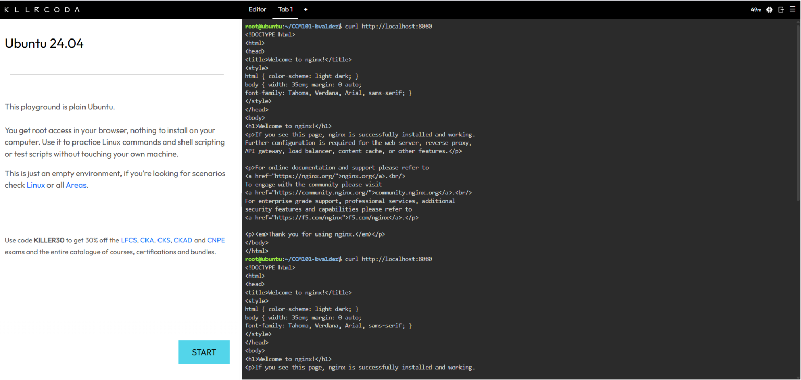
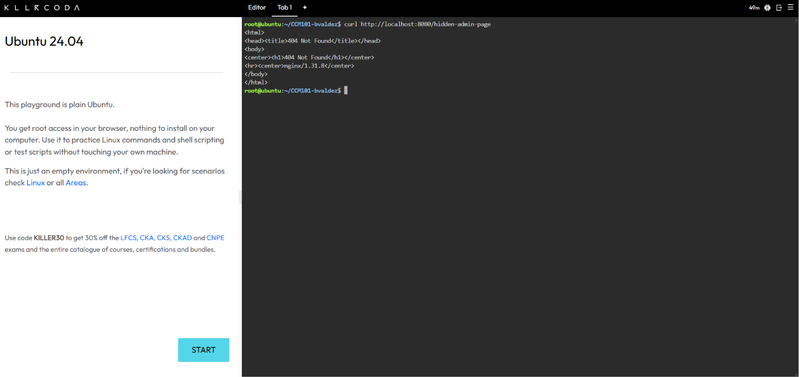
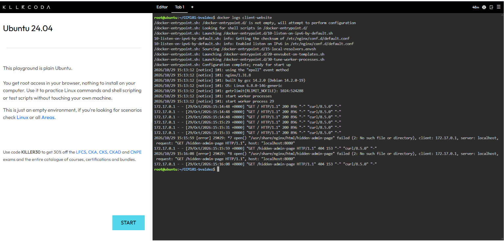
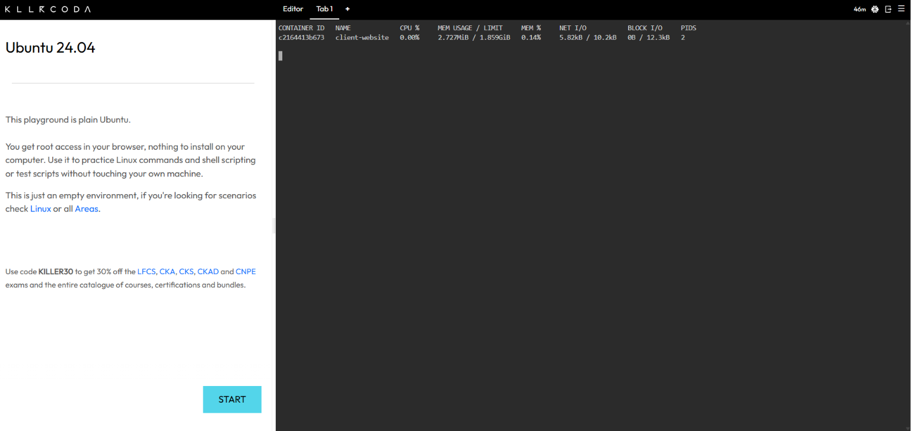

# Container Observability Report

**Container:** client-website (Nginx)
**Port mapping:** 8080 (host) → 80 (container)

## Deployment and Traffic Simulation

I deployed the client's web server with:

```bash
docker run -d --name client-website -p 8080:80 nginx
```

I then sent three normal requests with `curl http://localhost:8080` to simulate users visiting the site. I also requested `/hidden-admin-page`, which does not exist, to intentionally trigger a 404 error.







## Application Logs

Command used: `docker logs client-website`

The logs showed three successful requests (HTTP 200) and one failed request (HTTP 404). The line for the 404 error:

```
<<PASTE YOUR EXACT 404 LINE HERE>>
```

**Why application logs are vital for troubleshooting:** Logs record exactly what happened, when it happened, and which request caused it, so an engineer can trace a failure to its source instead of guessing. Without them, errors such as a missing page or a failed login would be invisible and much slower to fix.



## Real-Time Container Metrics

Command used: `docker stats`

| Metric | Value at time of screenshot |
|---|---|
| CPU % | <<e.g. 0.00%>> |
| Memory Usage | <<e.g. 7.5MiB>> |
| Network I/O | <<e.g. 1.2kB / 1.1kB>> |

**Conclusion:** At the time of the screenshot, the client-website container was using very little CPU and memory. <<Adjust to match your numbers.>> This is only a baseline, since four requests are far below the load of a real marketing surge.


