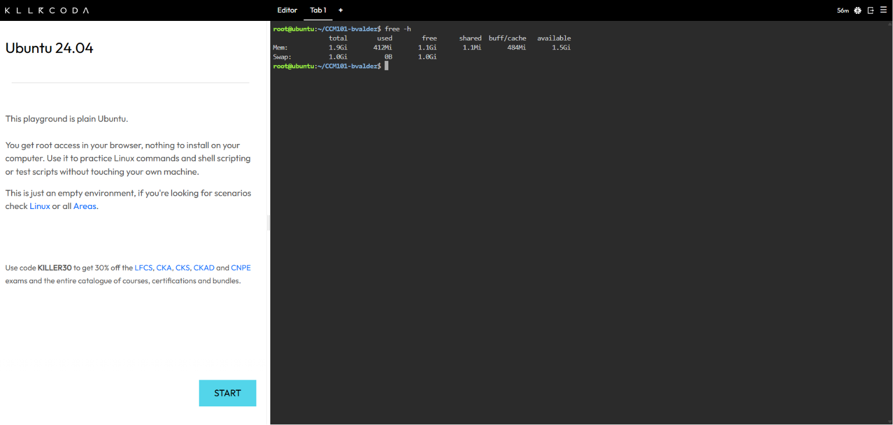
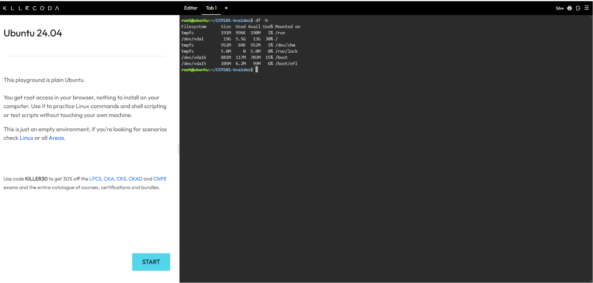

# System Baseline Report

## Host Resource Baseline

| Metric | Value | Command Used |
|---|---|---|
| Total RAM available | <<total from free -h, e.g. 1.9Gi>> | `free -h` |
| Total storage of root (/) file system | <<Size of / from df -h, e.g. 19G>> | `df -h` |

## CPU and Process Observation

I ran `top` and waited about five seconds to watch the CPU values shift before pressing `q` to exit. <<Describe what you saw, e.g. the server was mostly idle with a low load average.>>

## Why is checking disk space critical before a massive traffic surge?

Heavy traffic generates large volumes of logs, cache files, and temporary data, so a nearly full disk can crash the server and its applications exactly when demand is highest.

## Evidence

