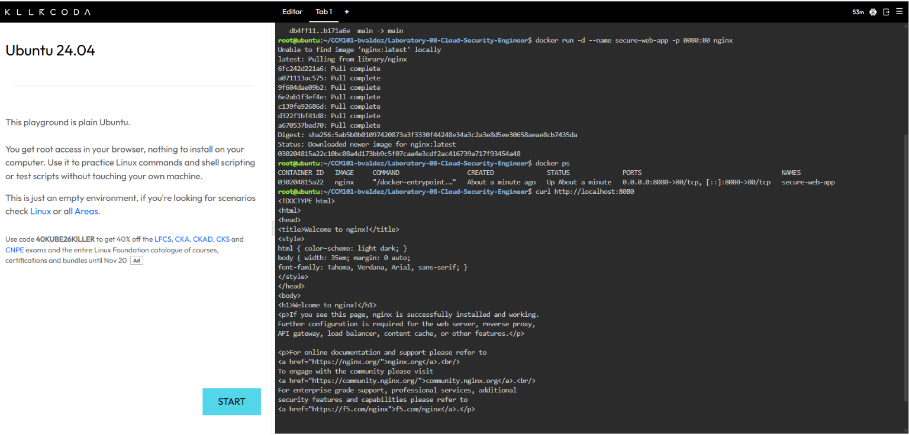
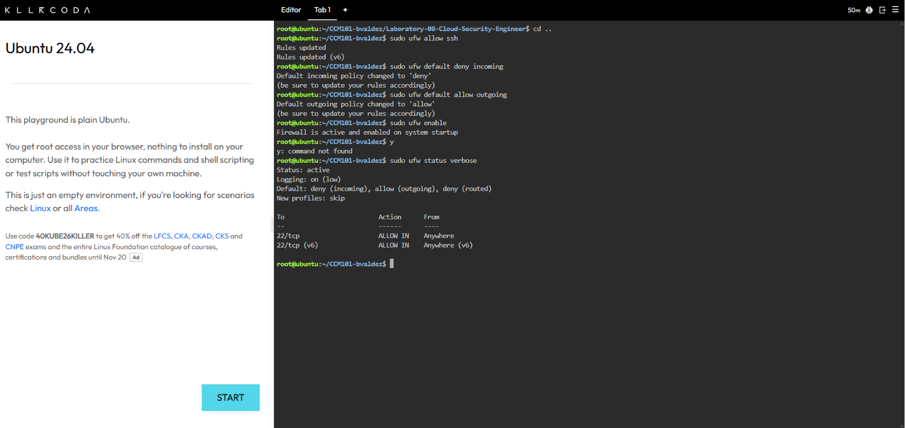
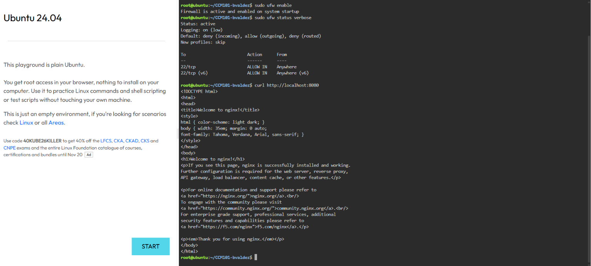
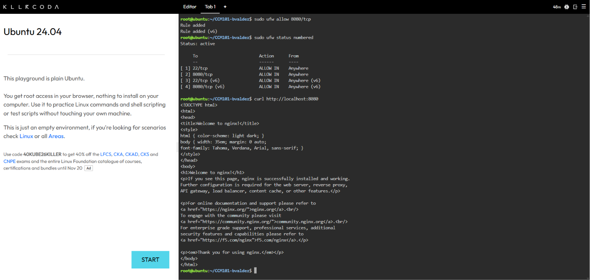

# Laboratory 08: Cloud Security Engineer

## Mission Overview
A new Ubuntu server for CloudNova Technologies was deployed without network security. My mission was to deploy an Nginx web application, audit the open ports, and lock the server down with UFW using a Default Deny policy, allowing only SSH (port 22) and the web application (port 8080).

## Objectives
- Understand the Attack Surface and the Principle of Least Privilege (PoLP)
- Perform a basic security audit of active network ports on a Linux server
- Configure the Uncomplicated Firewall (UFW) with a Default Deny policy
- Implement granular port management to selectively allow SSH and HTTP traffic
- Document firewall rules and security best practices using Markdown
- Continue expanding my GitHub Cloud Computing Portfolio

## Commands Executed
```bash
# Deploy the application
docker run -d --name secure-web-app -p 8080:80 nginx
curl http://localhost:8080

# Audit open ports
sudo ss -tulpn
sudo ufw status verbose

# Configure the firewall
sudo ufw allow ssh
sudo ufw default deny incoming
sudo ufw default allow outgoing
sudo ufw enable
sudo ufw status verbose

# Check before allowing the web port
sudo ufw status numbered
curl --max-time 5 http://localhost:8080

# Allow the web application
sudo ufw allow 8080/tcp
sudo ufw status numbered
curl http://localhost:8080
```

## Evidence






## Skills Learned
- Configuring UFW with a Default Deny policy
- Auditing listening ports with `ss`
- Allowing specific services with granular port rules
- Applying the Principle of Least Privilege to network access
- Verifying firewall behavior with `curl`
- Documenting security work in Markdown on GitHub
