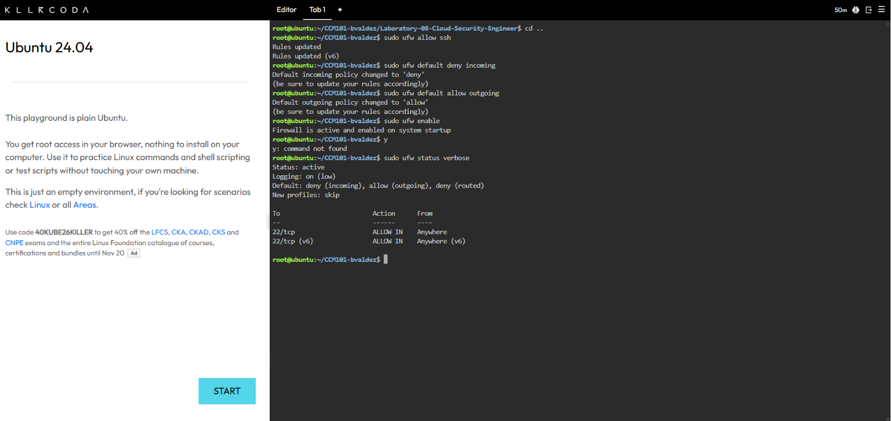
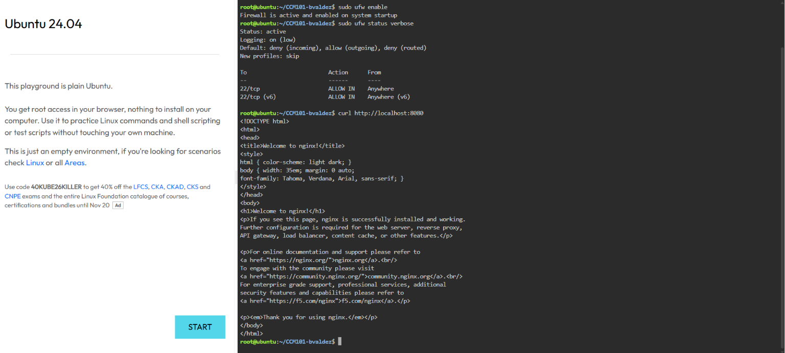
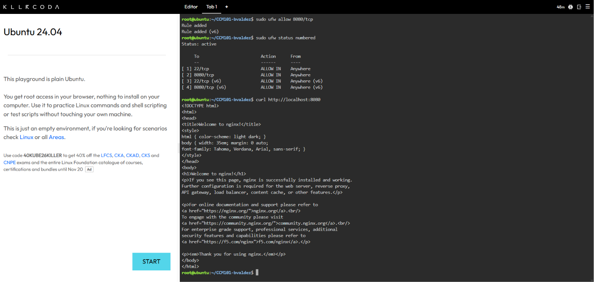

# Firewall Configuration

## 1. Allow SSH
```bash
sudo ufw allow ssh
```

## 2. Set the Default Deny Policy
```bash
sudo ufw default deny incoming
sudo ufw default allow outgoing
```

## 3. Enable the Firewall
```bash
sudo ufw enable
sudo ufw status verbose
```


## 4. Before Allowing Port 8080
```bash
sudo ufw status numbered
curl --max-time 5 http://localhost:8080
```


Result: [describe what happened, e.g. the request timed out / still succeeded]

## 5. Allow Port 8080
```bash
sudo ufw allow 8080/tcp
sudo ufw status numbered
curl http://localhost:8080
```


## What if `sudo ufw enable` ran before `sudo ufw allow ssh`?
The firewall would immediately block incoming SSH on port 22, locking the administrator out of the remote server.
