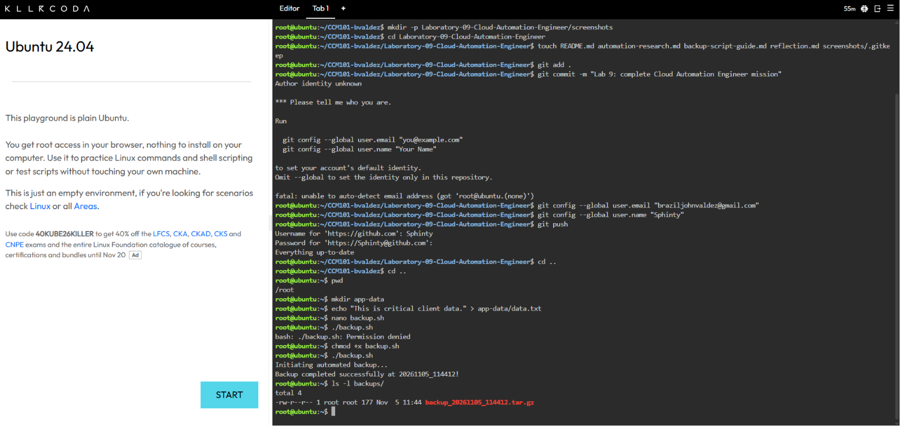
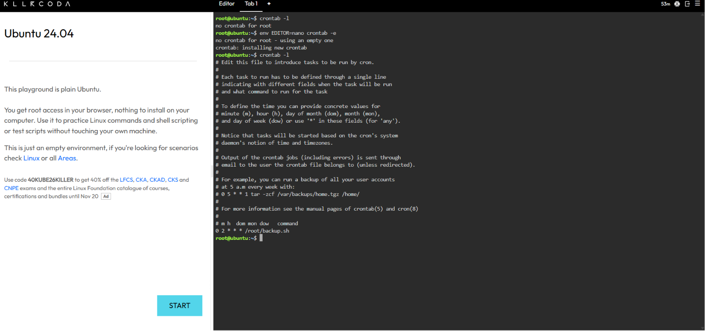

# Laboratory 09: Cloud Automation Engineer

## Mission Overview
Congratulations! Your ability to secure cloud environments has proven you are ready for the highest
level of operations. You have been promoted to the Cloud Automation and DevOps Team at CloudNova
Technologies.
Up until now, you have been acting as a traditional systems administrator—typing commands manually
one by one. In large enterprise environments scaling to thousands of servers, manual administration is too slow
and highly prone to human error. To survive at scale, you must learn to automate.
Using the KillerCoda Playground, you will step into the role of a Cloud Automation Engineer. You will
learn the basics of Bash shell scripting, create an automated backup routine, assign executable permissions, and
configure the Linux Cron scheduler to run your code autonomously.
Remember: If you have to do a task more than twice in the cloud, you should automate it.


## Mission Objectives
At the end of this laboratory activity, you should be able to:
- Understand the fundamental syntax of a Bash shell script, including variables and basic commands.
- Use a command-line text editor (nano) to write and save executable scripts.
- Modify Linux file permissions using the chmod command.
- Understand task scheduling and the syntax of a Linux crontab.
- Document automation code and Cron job configurations using Markdown.
- Complete the final chapter of your GitHub Cloud Computing Portfolio. 

## Commands Executed
```bash
# Create the dummy data
mkdir app-data
echo "This is critical client data." > app-data/data.txt

# Create the script
nano backup.sh

# Permissions and execution
./backup.sh
chmod +x backup.sh
./backup.sh
ls -l backups/

# Scheduling
crontab -l
env EDITOR=nano crontab -e
# Added: 0 2 * * * /root/backup.sh
crontab -l
```

## Evidence

### 1. Script execution (Checkpoint 4)

*The backup script runs and the `.tar.gz` file appears in the `backups/` folder.*

### 2. Cron schedule (Checkpoint 5)

*The installed crontab shows the 2:00 AM nightly job.*

## Skills Learned
- Writing Bash scripts with variables and command substitution
- Using nano to create and save scripts
- Changing file permissions with `chmod +x`
- Compressing directories with `tar`
- Scheduling automated tasks with cron expressions
- Documenting automation in Markdown on GitHub
