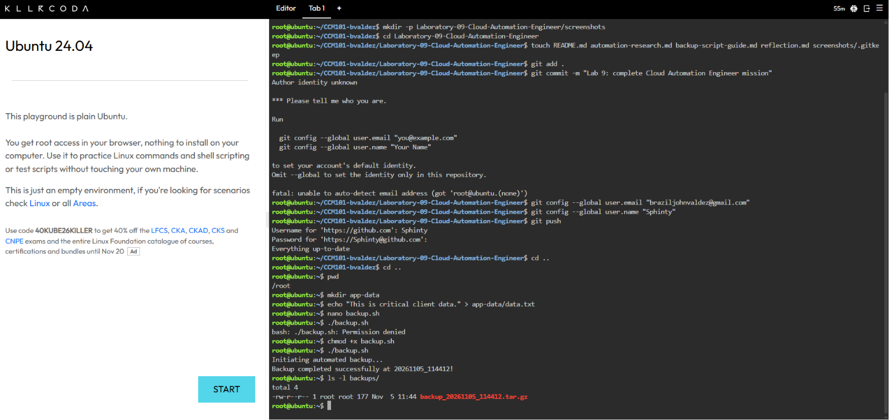
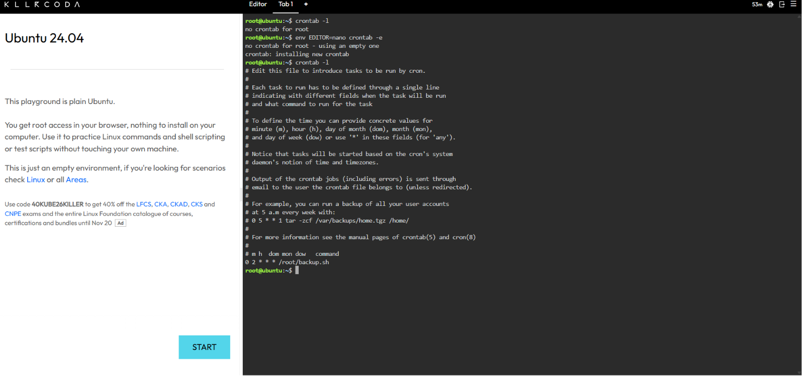

# Backup Script Guide

This guide explains the automated backup built for CloudNova Technologies so the client's IT team can understand and maintain it.

## The Script: `backup.sh`
```bash
#!/bin/bash
# Automated Backup Script for CloudNova Technologies

SOURCE_DIR="app-data"
BACKUP_DIR="backups"
TIMESTAMP=$(date +"%Y%m%d_%H%M%S")

echo "Initiating automated backup..."

# Create the backup directory if it does not exist
mkdir -p $BACKUP_DIR

# Compress the source directory into a tarball (.tar.gz)
tar -czf $BACKUP_DIR/backup_$TIMESTAMP.tar.gz $SOURCE_DIR

echo "Backup completed successfully at $TIMESTAMP!"
```

## Making the Script Executable
```bash
chmod +x backup.sh
```
The `chmod +x` command adds the execute permission to `backup.sh`. Before it, Linux treated the file as plain text and refused to run it ("Permission denied"). After it, the file can be run as a program with `./backup.sh`.

**Evidence:**

*The script runs successfully and `ls -l backups/` shows the compressed `.tar.gz` backup.*

## The Cron Schedule
```
0 2 * * * /root/backup.sh
```

| Field | Value | Meaning |
|-------|-------|---------|
| Minute | `0` | At minute 0 of the hour |
| Hour | `2` | At 2 AM (24-hour clock) |
| Day of Month | `*` | Every day of the month |
| Month | `*` | Every month |
| Day of Week | `*` | Every day of the week |

Together, this runs `/root/backup.sh` every night at exactly 2:00 AM.

**Evidence:**

*`crontab -l` shows the installed schedule.*
